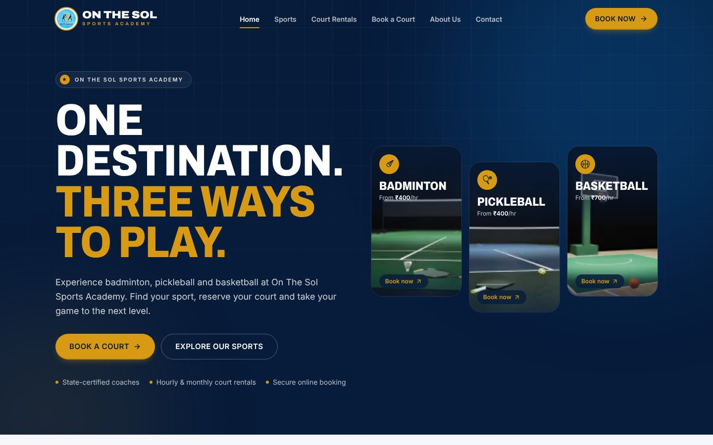
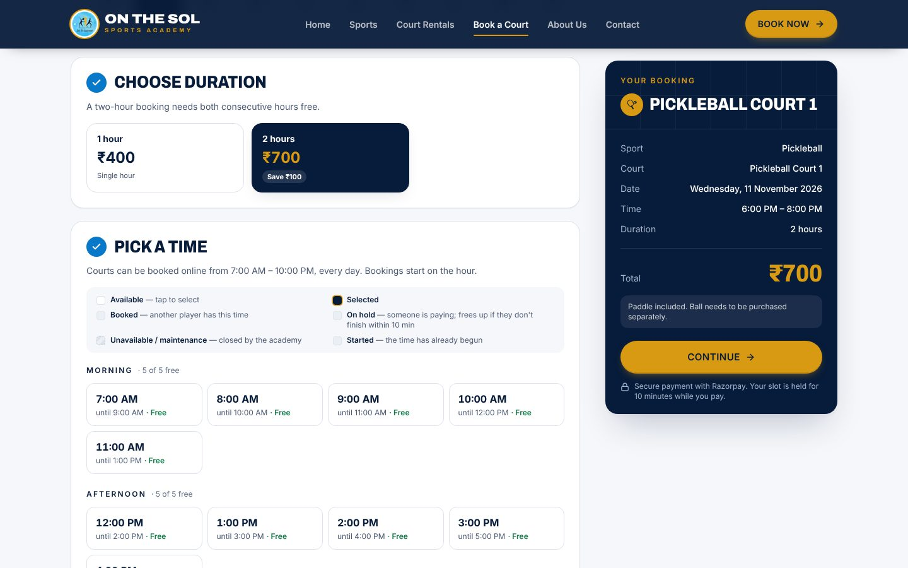
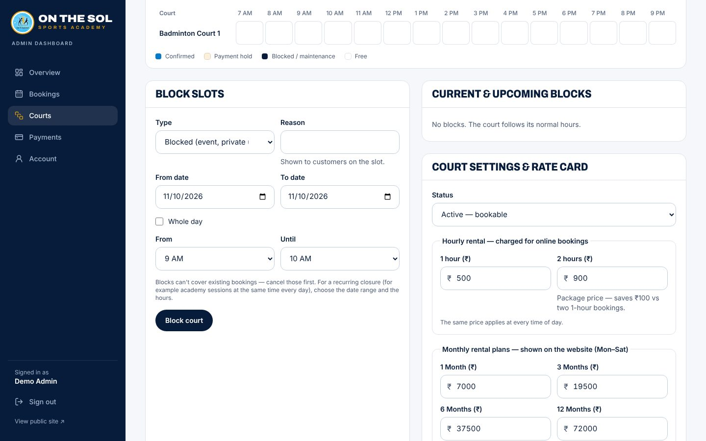
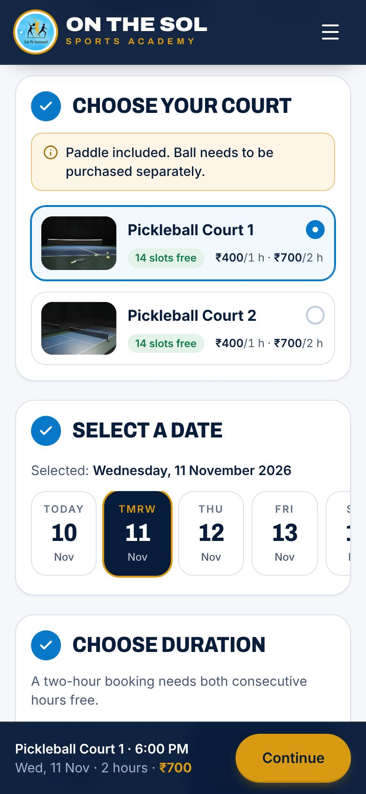
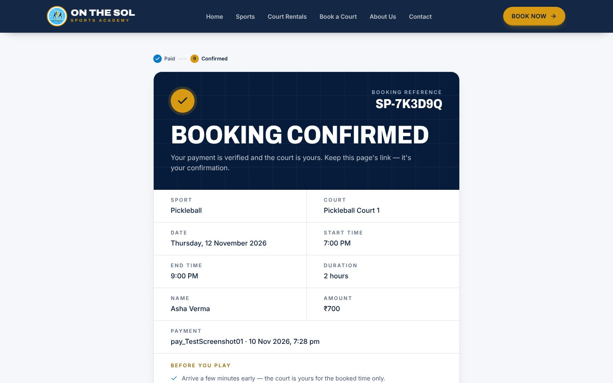

# On The Sol Sports Academy — court booking

A multi-sport academy website with the academy's published rate card, live court availability,
Razorpay checkout and a single admin dashboard. Badminton, pickleball and basketball are
presented with equal weight; courts are booked online for one or two hours, and monthly rental
plans (Monday–Saturday) are shown with an enquiry button.

Built with **Next.js 16 (App Router) · TypeScript · Tailwind CSS v4 · PostgreSQL · Drizzle ORM ·
Razorpay**. (The repository and package keep their original technical name, `smashpoint`.)

| Home | Booking | Admin |
| --- | --- | --- |
|  |  |  |

| Booking on a phone | Confirmation |
| --- | --- |
|  |  |

<sub>Screenshots from a local test run: Razorpay test mode with the test stand-in for Checkout
(`tests/fake-razorpay.ts`) and a test customer. No live payment was made.</sub>

## What it does

**Public site** (`/`) — navy, royal blue and gold brand from the academy's logo and rate card:
a hero with the three sports side by side, sport cards (badminton surfaces, pickleball paddle/ball
note), about, live court availability, the full **court rental & pricing** section (hourly and
monthly, from the database — a table on desktop, cards on phones), coaching credentials, why
choose us, the booking flow, contact details, and policy pages. No account is needed to book.

**Booking flow** — sport → court (with surface, live availability and prices) → date → 1 or
2 hours → time slot → name, email, mobile → summary → pay with Razorpay → confirmation page with
reference, calendar file and print view. Any "Book now" on the page pre-selects its sport or
court (`/?sport=pickleball#book`, `/?court=badminton-court-1#book`). Booked, held, blocked and
past slots are shown with their reason.

**Pricing** — every court has an exact one-hour and two-hour price (the two-hour price is a
package price, not twice the hourly price) and optional monthly plan prices. The same price
applies at every time of day — there is no peak surcharge. Prices are integer paise, edited in
`/admin/courts`, and the server always computes the amount charged.

| Rate card (₹) | 1 hour | 2 hours | 1 month | 3 months | 6 months | 12 months |
| --- | ---: | ---: | ---: | ---: | ---: | ---: |
| Badminton Court 1 – Green Mat (5 mm) | 500 | 900 | 7,000 | 19,500 | 37,500 | 72,000 |
| Badminton Court 2 – Wooden Finish (2.5 mm) | 400 | 700 | 6,000 | 16,500 | 31,500 | 60,000 |
| Pickleball (paddle included; ball purchased separately) | 400 | 700 | 5,500 | 15,000 | 27,500 | 50,000 |
| Basketball | 700 | 1,300 | 7,000 | 19,500 | 37,500 | 72,000 |

**Payments** — the server validates the slot, holds it for 10 minutes and creates a Razorpay
order; Checkout collects the payment; the server verifies the signature *and* fetches the
payment from Razorpay (order, amount, currency, status) before confirming. Webhooks and a
scheduled reconciliation job confirm payments whose browser callback never arrived. Everything
is idempotent; late or duplicate payments are refunded automatically.

**Admin** (`/admin`, one login, no public sign-up) — overview from real data (today's and
upcoming bookings, confirmed, pending payments, cancellations, amount collected), a day schedule
for all courts, booking search and detail with explicit *cancel* or *cancel and refund*,
per-court blocking for maintenance/events (never over an existing booking), each court's status,
surface and rate card (1 h, 2 h, monthly plans), the online booking hours, payments, password
change.

## Booking rules

| Rule | Where it's enforced |
| --- | --- |
| 2 badminton, 2 pickleball, 1 basketball court (stable slugs) | catalogue (`scripts/lib/catalogue.ts`) |
| Bookings within the online booking hours (setting; default 7:00 AM – 10:00 PM) | `src/lib/booking/rules.ts` + DB trigger (both read the `booking` settings row) |
| 1- or 2-hour bookings, starting on the hour | rules + DB trigger |
| Price = the court's 1-hour or 2-hour rate-card price, at any time of day | booking engine (`priceForDuration`), computed on the server |
| No overlapping active bookings on the same court | court row lock + `bookings_no_overlap` EXCLUDE constraint |
| Unpaid holds expire (10 min) and stop blocking the slot | booking service + scheduled job |
| Only verified payments confirm a booking | payment service |
| Price, end time and status are computed on the server | booking service (browser input is ignored) |
| No past dates; up to 30 days ahead | booking service |

The pure rules module is shared by the UI and the server; PostgreSQL enforces the same rules as
a backstop (`drizzle/0005_rental_pricing.sql`), so no code path can store a rule-breaking
booking. There is no sport-specific closure: a confirmed recurring closure (for example academy
sessions) is created as court blocks in `/admin/courts`.

## Quick start

Requirements: Node.js ≥ 20.9 and PostgreSQL 14+ (16 recommended).

```bash
docker compose up -d                      # or point DATABASE_URL at any Postgres
npm install
cp .env.example .env                      # set AUTH_SECRET, ADMIN_EMAIL, ADMIN_PASSWORD
npm run db:deploy                         # migrations + the courts and rate card + your admin account
npm run dev                               # http://localhost:3000  ·  admin: /admin/login
```

Without Razorpay keys the site works but online booking shows as unavailable. Add **test** keys
(`rzp_test_…`) to `.env` to try payments; see [docs/DEPLOYMENT.md](docs/DEPLOYMENT.md#razorpay).

## Environment variables

| Variable | Required | Purpose |
| --- | --- | --- |
| `DATABASE_URL` | yes | PostgreSQL connection string |
| `AUTH_SECRET` | yes | signs admin sessions and customers' booking links (≥ 32 random characters) |
| `RAZORPAY_KEY_ID`, `RAZORPAY_KEY_SECRET` | for payments | Razorpay API keys (server-side; only the key id reaches the browser) |
| `RAZORPAY_WEBHOOK_SECRET` | recommended | verifies Razorpay webhooks |
| `ADMIN_EMAIL`, `ADMIN_PASSWORD`, `ADMIN_NAME` | first deploy | creates the first administrator |
| `CRON_SECRET` | recommended | protects `/api/cron/reminders` (hold expiry, reconciliation, reminders) |
| `NEXT_PUBLIC_SITE_URL` | production | public URL for metadata and email links |
| `RESEND_API_KEY`, `EMAIL_FROM` | optional | confirmation, reminder and refund emails |
| `SEED_DEMO_DATA` | demo only | load the demo facility into an empty database |

## Commands

| Command | |
| --- | --- |
| `npm run dev` · `build` · `start` | Next.js |
| `npm run typecheck` · `npm test` | types · unit tests (pure logic) |
| `TEST_DATABASE_URL=… npm run test:integration` | services against a real, disposable Postgres + a fake Razorpay API |
| `E2E_DATABASE_URL=… npx playwright test` | browser tests, desktop and mobile |
| `npm run db:deploy` | release step: migrations, then first-run setup |
| `npm run db:migrate` · `db:generate` · `db:studio` | Drizzle |
| `npm run admin -- create <email> "Name"` · `password <email>` · `deactivate <email>` · `list` | administrator accounts |
| `npm run db:seed` / `db:reset` | demo data (refuses to wipe a non-demo database) |

## Project structure

```
src/app/(site)/          public pages: home, booking confirmation, policies
src/app/admin/           /admin/login and the admin dashboard
src/app/api/             availability, bookings, payment verify/webhook, cron, health
src/components/          home, booking wizard, admin, ui primitives, motion helpers
src/content/site.ts      academy name, motto and contact details (placeholders to replace)
src/content/sports.ts    how each sport is presented (copy, imagery, pickleball notice)
src/lib/pricing.ts       rate-card rows built from the courts' prices (shared by UI and JSON-LD)
src/lib/booking/         pure rules + availability engine (shared by UI and server)
src/server/services/     bookings (holds under a court lock), admin, scheduled jobs
src/server/payments/     Razorpay client + payment lifecycle
src/server/auth/         admin sessions (scrypt passwords, revocable sessions)
src/assets/images/       3D-rendered sports imagery (illustrative)
src/assets/brand/        the academy's logo emblem (cut from its rate card)
drizzle/                 migrations (0001 EXCLUDE constraint, 0004 archive, 0005 rate card + rules trigger)
scripts/                 release step, setup, demo seed, admin CLI
tests/                   integration + Playwright E2E, fake Razorpay API
```

## Testing

- **Unit** (`npm test`): the rate card (exact 1 h / 2 h / monthly prices per court, badminton
  surface mapping, shared pickleball tariff), no peak surcharge at any hour, booking hours and
  their normalisation (same check as the trigger), durations, availability engine, Razorpay
  signature checks and webhook parsing, production config checks.
- **Integration** (`npm run test:integration`): real PostgreSQL — catalogue and rate card, the
  one-time catalogue upgrade (keeps admin edits), server-side prices for every court and
  duration, every booking rule, configurable hours in the database trigger, 12 simultaneous requests for one slot (exactly one wins), overlapping
  1-/2-hour races, hold expiry and release, payment verification, forged signatures, amount
  tampering, authorized-then-captured payments, failed payments, late payments (refunded or
  re-activated), idempotency, reconciliation, refunds (immediate and pending), admin blocks.
- **End-to-end** (`npx playwright test`): the real UI on desktop and a phone viewport — the
  multi-sport home page and rate card, sport pre-selection, book and pay at the published
  price, abandoned checkout, webhook confirmation, tampered prices,
  access-token checks, admin sign-in/cancel-and-refund/sign-out, old routes, and that no secret
  reaches the browser.

Integration and E2E tests use `tests/fake-razorpay.ts`, a local stand-in for the parts of
Razorpay's API the app calls; it signs payments exactly as Razorpay documents, so the app's real
verification code runs. The override (`RAZORPAY_API_BASE_URL`) is ignored in production builds.
These tests don't replace a test-mode payment with real Razorpay keys before going live.

## Things to confirm with the academy before launch

- `src/content/site.ts`: phone, email, address, map search text, legal name and opening hours
  are `[placeholders]` (shown as such on the site and never linked) because the rate card
  doesn't include them. Monthly-plan and coaching "Enquire" buttons use the email (or phone)
  once it is set, and the contact section until then.
- **Online booking hours** (default 7 AM – 10 PM) — set the confirmed hours in `/admin/courts`.
- **Badminton academy sessions** — the earlier demo closed badminton 5–7 PM; it's no longer
  enforced. If the academy confirms a closure, add it as blocks in `/admin/courts`.
- **Number of pickleball courts** — the booking system has two; the site doesn't advertise a
  count until it is confirmed.
- The bracketed sections of the policy pages (cancellation terms, monthly plan terms, facility
  rules, data retention).
- Rate card values in `/admin/courts` (set from the academy's rate card; verify before launch).

The court images are illustrative 3D renders made for this project, not photos of the
facility (Court 2's render was recoloured to show its wooden finish); replace them with real
photography when available (`src/assets/images`). The logo emblem in `src/assets/brand` was cut
from the rate card image; replace it with the original artwork file when available.

## Upgrading from the academy-management version

Migration `0004` keeps all bookings and payments, moves the removed features' tables
(students, coaches, attendance, memberships, events, …) into the `legacy_archive` schema instead
of deleting them, and deactivates non-admin accounts. See
[docs/DEPLOYMENT.md](docs/DEPLOYMENT.md#upgrading-a-database-from-the-earlier-academy-app).
